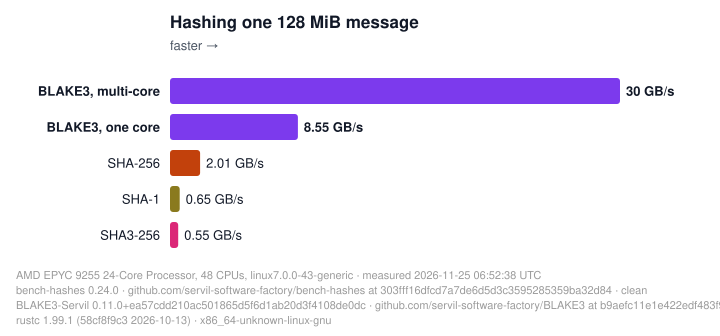

# blake3-servil

A fast [BLAKE3](https://blake3.io) implementation for 64-bit Arm and x86-64, from the
[Servil Software Factory](https://github.com/servil-software-factory).

**Before 1.0.** The Servil Software Factory aims at software that serves its users reliably
and loyally; [its page](https://github.com/servil-software-factory) says how, and what it
promises for a project it supports. It counts a project as supported from version 1.0.
blake3-servil is at 0.11, its first candidate: [SECURITY.md](SECURITY.md) says what we do
about a vulnerability today, and the API may still change between minor versions.

## How fast



Speed depends on your machine and on how your program hashes.
[bench-hashes](https://github.com/servil-software-factory/bench-hashes) measures both on your own
computer; its published maps cover an [Apple M4 Max](https://servil-software-factory.github.io/bench-hashes/benchmark-results/AppleM4Max.darwin25/bench-hashes.map.html),
an [AMD EPYC 9255](https://servil-software-factory.github.io/bench-hashes/benchmark-results/AMDEPYC925524CoreProcessor.linux70038generic/bench-hashes.map.html),
and an [Intel i7-12700K](https://servil-software-factory.github.io/bench-hashes/benchmark-results/12thGenIntelRCoreTMi712700K.linux70042generic/bench-hashes.map.html);
[an overview](https://servil-software-factory.github.io/bench-hashes/) sets every machine side by side.

We measure and tune on one memory node. On Linux, the library keeps its
workers on one node, within the CPUs the initializing thread is allowed:
that thread's node or, where another node holds at least twice as many
of those CPUs, the node that holds the most. `b3sum` keeps its calling thread and workers
within the same node when a run uses multiple threads (deferred until
default thread-count discovery is needed, eager for `--num-threads` > 1). The
application still controls its own threads and buffer placement. This is
for speed, and no hash depends on it. On a machine with several memory
nodes it needs the node topology under `/sys/devices/system` to be
readable and `sched_setaffinity` to be allowed: where a sandbox hides the
one, no node is chosen, and where it refuses the other for a thread, that
thread runs on the CPUs it has. (A pool of one thread asked for by
number, `initialize_multithreaded(NonZeroUsize::new(1))`, has no workers,
so it reads no topology and binds nothing; `b3sum` likewise skips
topology discovery and binding for `--num-threads 1` and single-threaded
paths that never ask for workers, such as hashing one small regular file.)

## How it is checked

**It is new.** AIs wrote it under Zooko's direction, and no human has reviewed it line
by line or audited it. You would be among its first users.

Its checks go further than most:

- Assembly kernels are checked against BLAKE3's specification with **symbolic proofs**.
  [QUALITY.md](QUALITY.md) explains the proof coverage and its scope.
- **The tests are tested:** more than 2,000 small mistakes are planted in the Rust code,
  one at a time, and the tests are checked against each one.
- Digests are checked against the official test vectors and fixed answers from official
  BLAKE3, and each process checks its kernels before its first hash.
- Memory use is checked with guard pages that catch a kernel reading one byte too far.

Details: [`QUALITY.md`](QUALITY.md). The practices every Servil Software Factory project is
to share: [the Factory's page](https://github.com/servil-software-factory).

## Using it

```toml
[dependencies]
# A release by its full version and its commit's full hash: Cargo fetches
# exactly that commit (and reads the version up to the "+" today).
blake3-servil = { git = "https://github.com/servil-software-factory/BLAKE3", rev = "<the release's commit>", version = "=<X.Y.Z+hash>" }
```

`git ls-remote --tags https://github.com/servil-software-factory/BLAKE3` lists each
release, `vX.Y.Z+<hash>`, with its commit. The hash in a release's
version names the commit of its code, so the version alone identifies
what you have (`b3sum --version` and the C library's `b3_version()`
print it). The code after a release reads `X.Y.Z+dev`, "newer than
X.Y.Z", and a build of it prints its commit too, and from a dirty tree the
Git tree id of its working tree: `0.11.0+dev.<commit>.dirty.<tree>`. Write
it whole wherever you write it: tools that check it may come.

```rust
blake3_servil::initialize(); // once, before any other call
let hash = blake3_servil::convenience::hash(b"foobarbaz");
```

`blake3-servil-core` provides everything except multithreading, running on the calling thread with zero background threads and zero third-party runtime or build dependencies (no C compiler needed), including fixed-length `Packed<16/32/48>` batch hashing and single-template `hash_counter_range` across all four SIMD backends. `blake3-servil` re-exports `blake3-servil-core` and adds multithreading: a multithreaded form of each call, and the `Pipeline`, which hashes a stream of messages as they arrive (with streaming `room`/`commit`, zero-copy caller-owned buffers via `Pipeline::with_owners` + `Pipeline::owned`, fixed-length `Batch`es and `Packed<16/32/48>` batches via `Pipeline::with_batches`, and per-message `Mode` via `Pipeline::message_with`).

The [crate documentation](https://servil-software-factory.github.io/BLAKE3/blake3_servil/) covers the
calls for programs that hash a lot, and the C library in [`capi/`](capi/).
[`b3sum/README.md`](b3sum/README.md) covers the command-line tool.

It runs on 64-bit Arm (Linux, macOS) and x86-64 (Linux, a CPU with SSSE3 and SSE4.1: Intel since
2008, AMD since 2011) with the latest stable Rust; [official BLAKE3](https://github.com/BLAKE3-team/BLAKE3)
serves other platforms.

## About BLAKE3

BLAKE3 is a cryptographic hash function: fast, secure, and parallel, serving as a hash,
MAC, KDF and XOF. It was designed by Jack O'Connor, Samuel Neves, Jean-Philippe Aumasson
and Zooko; the [paper](https://github.com/BLAKE3-team/BLAKE3-specs/blob/master/blake3.pdf)
gives the design and [C2SP](https://c2sp.org/BLAKE3) the specification. It is not a
password hash; for passwords, use [Argon2](https://github.com/P-H-C/phc-winner-argon2).

Other implementations: [official BLAKE3](https://github.com/BLAKE3-team/BLAKE3) in Rust
and C, and its [reference implementation](https://github.com/BLAKE3-team/BLAKE3/blob/master/reference_impl/reference_impl.rs),
the clearest place to see how BLAKE3 works.

## What comes from official BLAKE3

This is a fork of official BLAKE3 1.8.7, and much of what makes it good is theirs. On
x86-64, compression runs Samuel Neves' SSE4.1, AVX2 and AVX-512 assembly, renamed and
with one fix, except where BLAKE3-Servil's own kernels below take over; the speed of a single
message there is his, except on AMD Zen 5 and later. The API (`Hasher`, `update`,
`finalize`, `finalize_xof`, `OutputReader`, `Hash`, key derivation) and the crate's architecture are
Jack O'Connor's, kept and rebuilt around. `b3sum`'s command line and checkfiles and the test
vectors are the BLAKE3 team's. What this fork adds: the
64-bit Arm kernels (NEON with integer lanes, and SME2), the x86-64 kernels for whole
chunks with a partial one, for the chunk root and, on AMD Zen 5 and later, for 32 chunks
or 16 parent nodes at once, the thread pool, the batch calls, the Pipeline, the tree
API, the C API, the
proofs, and the tests of the tests.

## Contributing and licenses

[CONTRIBUTING.md](CONTRIBUTING.md) says how to work on this repository.

Copyright (c) the BLAKE3-Servil contributors. You may use BLAKE3-Servil under the terms of any of these
four Free and Open Source Software licences, at your choice:

* MIT license ([LICENSE-MIT](LICENSE-MIT))
* Apache License, Version 2.0 ([LICENSE-APACHE](LICENSE-APACHE))
* Transitive Grace Period Public Licence 1.0 ([LICENSE-TGPPL](LICENSE-TGPPL)):
  *Licensed under the Transitive Grace Period Public Licence version 1.0*
* Bootstrap Open Source Licence v1.0 ([LICENSE-BOSL.txt](LICENSE-BOSL.txt)):
  *Licensed under the Bootstrap Open Source Licence version 1.0*

BLAKE3-Servil began as a fork of [BLAKE3](https://github.com/BLAKE3-team/BLAKE3), whose authors
released it into the public domain under CC0 1.0; their code is used here on those terms.
