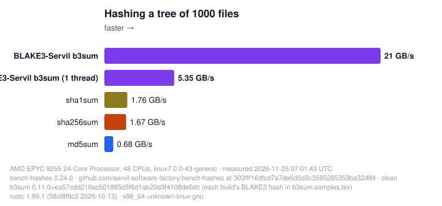

# b3sum

A command-line tool that prints [BLAKE3](https://blake3.io) hashes of files or
standard input, like `sha256sum` or `md5sum`. This is `blake3-servil`'s
`b3sum` (see the repository's [README](../README.md)).



# Installation

## Prebuilt Linux binaries

Download `b3sum-VERSION-x86_64-unknown-linux-gnu` or
`b3sum-VERSION-aarch64-unknown-linux-gnu` and its `.sha256` file from the
[releases page](https://github.com/servil-software-factory/BLAKE3/releases).
These binaries are statically linked, so they start faster when invoked many
times (for example, once per file). Check the digest, make the binary executable,
and move it to a directory on your `PATH` as `b3sum`:

```bash
sha256sum -c b3sum-VERSION-TARGET.sha256
chmod +x b3sum-VERSION-TARGET
```

## Verify a Linux binary by rebuilding it

The Linux release binaries are reproducible (for releases after 0.9.0). From a
checkout of a release tag, you can rebuild them in Docker or Podman and verify
that your build matches the published file byte for byte:

```sh
docker run --rm -v "$PWD":/src -w /src ubuntu:26.04 sh tools/b3sum-release-container.sh
sha256sum dist/b3sum-*
```

## Build from source

With [Rust and Cargo](https://doc.rust-lang.org/cargo/getting-started/installation.html):

- On Linux (recommended static build; use `aarch64-unknown-linux-gnu` on 64-bit
  Arm):

  ```bash
  RUSTFLAGS="-C target-feature=+crt-static" cargo install b3sums --target x86_64-unknown-linux-gnu
  ```

- On macOS:

  ```bash
  cargo install b3sums
  ```

The package name on crates.io is **`b3sums`** (the `b3sum` package is official
upstream BLAKE3). Installing `b3sums` puts the `b3sum` binary in `~/.cargo/bin`.

Packagers building a release binary from a tag checkout can run
`sh tools/b3sum-release.sh`. It builds from a fresh clone of the tag's commit
and writes a `.sha256` file beside the binary.

# Example

```bash
b3sum foo.txt
```

To time hashing a 1 GB file on your machine:

```bash
head -c 1000000000 /dev/zero > /tmp/bigfile
time sha256sum /tmp/bigfile
time b3sum /tmp/bigfile
```

# Usage

```
Usage: b3sum [OPTIONS] [FILE]...

Arguments:
  [FILE]...  Files to hash, or checkfiles to check

Options:
      --keyed                 Use the keyed mode, reading the 32-byte key from stdin
      --derive-key <CONTEXT>  Use the key derivation mode, with the given context string
  -l, --length <LEN>          The number of output bytes, before hex or sigil encoding [default: 32]
      --seek <SEEK>           The starting output byte offset, before hex or sigil encoding
                              [default: 0]
      --num-threads <NUM>     The most threads hashing at once [default: as fast as b3sum can]
      --no-mmap               Read every file and map none: a file that another program shortens
                              while b3sum hashes it then cannot stop the run
      --no-names              Omit filenames in the output
      --raw                   Write raw output bytes to stdout, rather than hex
      --sigilcode             Write each hash as a sigil (25 characters for 32 bytes; see
                              johnservil/sigil), rather than hex; with --check, read sigils as well
                              as hex
      --tag                   Output BSD-style checksums: BLAKE3 ([FILE]) = [HASH]
  -c, --check                 Read BLAKE3 sums from the [FILE]s and check them
      --quiet                 Skip printing OK for each checked file
      --outboard <DIR>        Also write each file's outboard to DIR/<HASH>.obao4: its BLAKE3 tree
                              over 16 KiB chunk groups in bao-tree's pre-order form, for verified
                              streaming
  -h, --help                  Print help
  -V, --version               Print version

More information: b3sum/README.md at
https://github.com/servil-software-factory/BLAKE3/blob/main/b3sum/README.md
```

By default, `b3sum` uses all CPU cores: it hashes multiple files in parallel and
splits large files across threads. Pass `--num-threads 1` to use a single
thread. On Linux, `taskset -c LIST b3sum ...` pins `b3sum` to specific CPUs.

See [What `--check` does](what_does_check_do.md) for checkfile rules.

## What b3sum reads

`b3sum` hashes the file it opened. If the name is moved or given to another
file during the run, the file hashed is still the one that was opened.

**Hash files that are not changing.** `b3sum` takes no lock and no snapshot.
If another program writes to a file while `b3sum` hashes it, the hash printed
may be of bytes that the file never held all at once.

How much of the file is hashed depends on how `b3sum` takes it in:

- **Read** (files under 512 KiB, standard input, every file with `--no-mmap`,
  and on Linux most files the page cache does not hold): `b3sum` reads until
  the system says
  the file has ended. The size the file reported at the start is not used.
  So a file that reports 0 bytes and has some (as under `/proc`) is hashed
  whole.
- **Mapped** (other files of 512 KiB or more): `b3sum` hashes the bytes up to
  the size the file had when it was opened.

What happens when a file changes during the run:

| The file... | Read | Mapped |
|---|---|---|
| grows at its end | the added bytes are hashed if they arrive before `b3sum` reaches the end | the added bytes are not hashed |
| is cut short | if `b3sum` had already read past the new end, it prints the hash of what it read: a file that never existed | `b3sum` stops with an error and prints no hash, unless the cut falls inside the file's last page of memory (4 KiB on most machines): then the missing bytes read as zeros, and it prints the hash of a file that never existed |
| is overwritten in place | old bytes and new bytes may be mixed | the same |

`b3sum` does not yet detect these cases
([#443](https://github.com/servil-software-factory/BLAKE3/issues/443)).

## Direct I/O for large cold files

On Linux, `b3sum` reads cold files of 4 MiB or more with direct I/O (bypassing
the page cache) when hashing a single file, or when hashing any file with
`--outboard`. Bypassing the cache avoids extra memory copies and leaves the page
cache undisturbed when hashing large sets of files once. On a Ryzen 9700X with
NVMe storage, hashing a cold 1 GiB file drops from 0.22 s through the page cache
to 0.10 s with direct I/O.

## Outboards for verified streaming

`--outboard DIR` writes each file's outboard tree to `DIR/<HASH>.obao4`. This
lets a streaming receiver verify any part of the file against its root hash as
that part arrives.

- The format matches `bao-tree`'s `PreOrderMemOutboard::create` with block size
  4 (16 KiB chunk groups): 64-byte parent nodes in pre-order, with no length
  prefix.
- Files of 16 KiB or less have no parent nodes, so no `.obao4` file is written.
- `DIR` must already exist.
- Works in plain mode and `--keyed` mode.

```bash
$ mkdir outboards && b3sum --outboard outboards big.iso
5da5ad397cd129294c30f415b7d4e091b155a5faa37ba0b154ed10a5e5dbfca9  big.iso
$ ls outboards
5da5ad397cd129294c30f415b7d4e091b155a5faa37ba0b154ed10a5e5dbfca9.obao4
```

## Hashes as sigils

`--sigilcode` prints each 32-byte hash as a 25-character
[sigil](https://github.com/johnservil/sigil) instead of hex. A sigil is a
single word (easy to double-click to select), uses visually distinct characters,
and includes its own error check so typos or swapped adjacent characters fail
before hashing begins. With `--check --sigilcode`, checkfiles may mix sigils and
hex.

```
$ b3sum --sigilcode empty
ᢳᕌᔃጾዿᑂഔጕꔍⶰᣟꕄꕛቴⴲజᐽᙿᕯⶂጁᑃሃᛜጩ  empty
$ b3sum --sigilcode empty > sums.b3 && b3sum --sigilcode --check sums.b3
empty: OK
```

Without `--sigilcode`, `b3sum` expects hex only, and `--check` will tell you if
a line looks like a sigil.
